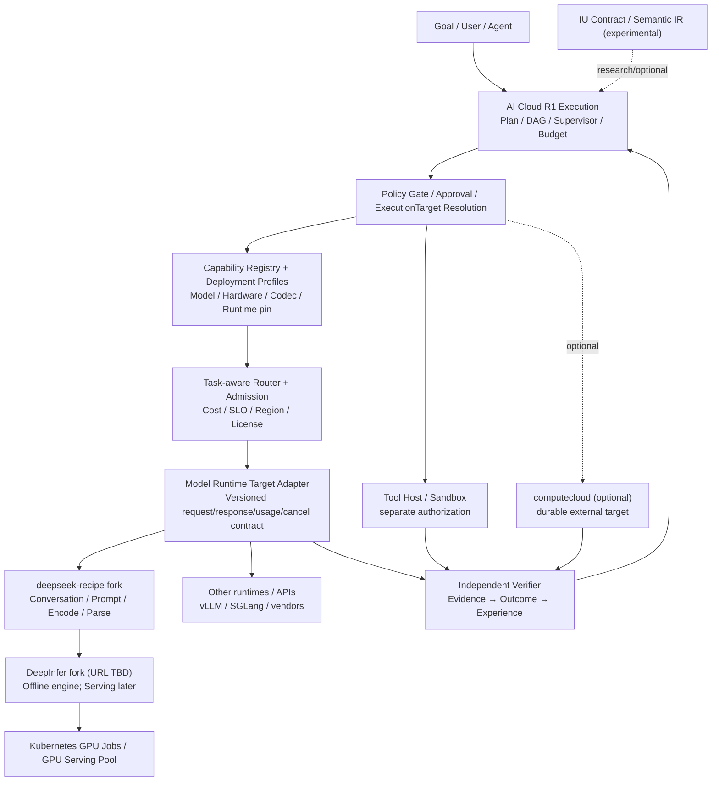

# DeepSeek Recipe + DeepInfer Integration: AI Cloud Architecture and Iteration Roadmap

> Status: Proposal / review required · 2026-10-21 · **English** | [简体中文](deepseek-inference-integration.zh-CN.md)
>
> This design extends the current AI Cloud R1 Execution OS direction: Goal → Execution → ExecutionPlan → ExecutionTarget → Evidence → Outcome → Experience → Improvement. It is not a claim of production verification.

## 1. Decision Summary

1. AI Cloud retains the Execution control plane, policy, ExecutionTarget, capability registry, model router, deployment profiles, Evidence/Outcome, and evaluation. Add a **Model Runtime Target Adapter** rather than embedding the DeepInfer kernel into the control plane.
2. `deepseek-recipe` provides pinned protocol conversion, Conversation/Prompt/tokenization and output parsing. It does **not** perform inference, authorize tool execution or verify task outcomes.
3. `DeepInfer` is an optional high-performance inference backend. Start with **P0 offline batch inference**. Public offline capability does not imply complete online serving: KV lifecycle, continuous serving scheduler, prefill/decode disaggregation and cross-replica routing require separate development and validation.
4. Optional `computecloud` integration remains a durable Job/Stage/Task/Attempt/Artifact worker execution target, not an LLM gateway or serving platform.
5. **IU** remains a research-level verifiable task semantics and strategy contract, distinct from tokens, MoE experts, and individual inference calls.
6. Accessible fork identified: `tommyxie2026-tech/deepseek-recipe`. A DeepInfer fork could not be located in the connected GitHub account during this review; its repository URL remains configurable.

## 2. Architecture Increment

**Two scheduling scales:** AI Cloud schedules goals, execution targets, budgets, policies and model capabilities. DeepInfer optimizes model-internal batching, accelerators, experts and speculative decoding. Token draft acceptance is not task verification.

## 3. Contracts and Ownership

| Interface | Owner | Required behavior |
|---|---|---|
| ExecutionTarget `model-runtime` | AI Cloud | Target ID, revision, capabilities, region, policy, budget, idempotency references |
| ModelCallRequest / Result | AI Cloud Adapter | IDs, exact model/codec/runtime revisions, input constraints, usage, finish reason, categorized errors |
| Conversation / Prompt IR | Recipe | Versioned conversion; reject loss of required semantics |
| Inference engine | DeepInfer | Tokens, resource use and inference performance; distinguish offline vs online support |
| Verifier / Outcome | AI Cloud | Independently check format, functionality, environment and evidence; never model-self-grade success |
| Job/Attempt (optional) | computecloud | Durable execution, cancellation, retries and artifacts, not model routing |

**Capability negotiation:** `tools`, `image`, `strict_json_schema`, `stream`, `cancel` must be checked for actual backend enforcement. Missing required capabilities cause fail-closed rejection. Proposal-only Deployment Profile fields: `model_id`, `model_revision`, `tokenizer_revision`, `recipe_sha`, `deepinfer_sha`, `runtime_image_digest`, `accelerator_kind`, `gpu_model`, `tensor_parallel`, `kv_cache_policy`, `capability_flags`, `region`, `data_classification`, `license_review`, `benchmark_ref`, `rollout_state`.

## 4. Milestones and Dependencies

| Milestone | Deliverable | Dependency | Gate |
|---|---|---|---|
| M0 Fork/Capability Baseline | Fork SHAs, upstream sync, license, hardware/driver/CUDA and offline API matrix | None | Proven versions and support constraints; unresolved forks blocked |
| M1 Codec Contract | Isolated Recipe adapter, tokenizer pin, negative semantic-loss cases, tests | M0 | No silent loss of required features |
| M2 Offline Model Target | DeepInfer offline adapter, GPU Job, immutable input/output and attempt idempotency | M1 + compatible accelerator | Smoke/failure/accuracy/security checks pass |
| M3 Control-plane Integration | ExecutionTarget, Policy/Budget/Router, Usage/Evidence/Outcome, alerts | M2 | Full audit and enforced budget/permission/outcome |
| M4 Online Serving Spike | Real HTTP/SSE, cancellation/backpressure, KV, P/D and replica routing PoC | M3 | Correctness and performance validated before production |
| M5 Production Rollout | Canary, automatic rollback, recovery, SLO, verified-outcome cost/quality | M4 | Release gates green; change reversible |
| M6 IU Experiment (optional) | IU Contract → model conversation → verifier; matched-budget A/B | M2/M3 | Advance only if independently demonstrated net benefit |

M2 only targets authorized offline asynchronous inference. A completed Kubernetes Job is not proof of a successfully committed business outcome. Do not turn `offline_inference.py` into an exposed public online API.

## 5. Issue / Workstream Breakdown

- **WS-A Registry & Profile:** precise model, tokenizer, codec, runtime commits; hardware topology, license, jurisdiction, compatibility and drift.
- **WS-B Recipe Adapter:** protocol mappings, semantic-loss failures, tool declaration vs authorization, limits, injection tests.
- **WS-C DeepInfer Offline Target:** Kubernetes GPU Job, immutable digest and weights, quotas/cancel, idempotent attempt output.
- **WS-D Governance & Evidence:** policy/approval/budget/traces, independent verifier, end-to-end correlation IDs.
- **WS-E Observability & Cost:** Prometheus/OTel, TTFT/TPOT, tokens/s/GPU, queue/cache/VRAM, cost per independently verified outcome including retries/tools.
- **WS-F Online Spike:** KV lifecycle, continuous scheduling, SSE, P/D separation, replica routing; scope after measurement.
- **WS-G IU Research:** matched-budget monolithic, multi-sample, static DAG and dynamic IU comparisons isolated from production.

WS-A/B/C may proceed in parallel; WS-D depends on a frozen contract; WS-E instrumentation starts with M1; WS-F does not block offline P0.

## 6. Production, Security, Observability and Rollback Gates

- **Security:** OIDC/mTLS, RBAC, namespace/network isolation, image signature/SBOM, least-privileged secrets, isolated tool host, tenant/data classification, SSRF protection for remote images; never expose raw GPU jobs publicly by default.
- **Release:** pin reviewed upstream/fork commits, immutable image digests, model checksums and licenses; admit validated accelerators; shadow/canary first; roll back unhealthy profiles.
- **Correctness:** input/output coverage, idempotent commit, retry/cancel/restart recovery, codec semantic-loss detection, actual JSON constraint enforcement and independent task evaluation.
- **Telemetry:** log execution/attempt/request IDs, exact model/recipe/deepinfer revisions, region/GPU, token usage, queue and inference timing, errors and verifier results. Do not log private prompts or reasoning traces by default.
- **Performance:** benchmark contexts, concurrency, lengthy outputs, batch mixes, failure injection, throughput, P95/P99, TTFT/TPOT and cost per verified task; vendor figures are not production SLAs.
- **Rollback:** route to previous stable target/profile, drain/cancel in-flight work, preserve durable evidence; never assume external side effects can be reverted.

## 7. Roadmap and DevDocs Boundaries

This is an additive R1 `model-runtime` ExecutionTarget and inference registry/router/verifier design, **not a second Execution OS**. Keep exploratory research in `devdocs`; this document is a `docs` design proposal. Promote schemas, implementation, ADRs and roadmap commitments only after M0/M1 validation.

References: [Official DeepInfer](https://github.com/deepseek-ai/DeepInfer) · [Official Recipe](https://github.com/deepseek-ai/deepseek-recipe) · [Recipe fork](https://github.com/tommyxie2026-tech/deepseek-recipe) · [IU study](https://github.com/tommyxie2026-tech/devdocs/pull/17).
