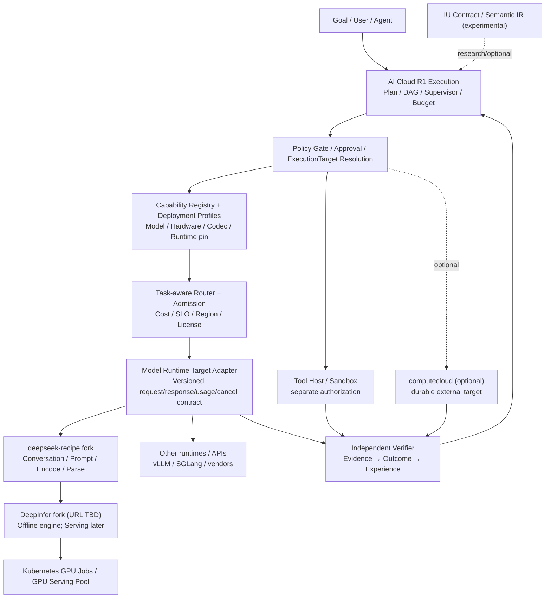

# DeepSeek Recipe + DeepInfer 与 AI Cloud 的推理底座集成架构及迭代路线

> 状态：Proposal / 待评审 · 2026-10-21 · [English](deepseek-inference-integration.md) | **简体中文**
>
> 本文在当前 AI Cloud R1 Execution OS 主线之上提出增量，不改变 Goal → Execution → ExecutionPlan → ExecutionTarget → Evidence → Outcome → Experience → Improvement 的控制面。不是已验证的生产部署报告。

## 1. 决策摘要

1. AI Cloud 继续拥有 Execution 控制面、Policy、ExecutionTarget、Capability Registry、模型路由、Deployment Profile、Evidence/Outcome 与 Eval；新增 **Model Runtime Target Adapter**，不将 DeepInfer 代码复制进核心服务。
2. `deepseek-recipe` 负责版本固定的协议转换、Conversation/Prompt/Tokenizer 和输出解析；**不负责模型执行、工具授权或任务验收**。
3. `DeepInfer` 作为可选高性能原生推理后端；部署路径从 **P0 离线批推理**起步。现有公开能力不能等同完整在线 Serving；在线 KV Cache 生命周期、持续服务调度、P/D 拆分、跨副本路由须单独实现/验证。
4. `computecloud` 如被接入，仅负责 durable Job/Stage/Task/Attempt/Artifact 与 Worker 执行，不承担网关或模型 Serving；跨项目集成为可选 ExecutionTarget。
5. **IU** 是未来可验证任务语义/策略与实验契约，不能等同 Token、MoE Expert 或一次 API 请求；其验证与学习闭环不得混入推理 Kernel。
6. 当前可访问 fork：`tommyxie2026-tech/deepseek-recipe`；本次未在当前 GitHub 连接中定位到 `DeepInfer` fork，故部署仓库 URL 保留可配置，绝不假设 fork 已可拉取。

## 2. 目标架构（迭代增量）

**两级调度**：AI Cloud 按 Goal/ExecutionTarget/预算和模型能力调度任务；DeepInfer 在模型内部按 Batch、GPU、专家和推测解码优化。不得把模型 Token 验证率当作任务验证成功率。

## 3. 关键契约与职责

| 接口 | 所有者 | 必须保持的性质 |
|---|---|---|
| ExecutionTarget `model-runtime` | AI Cloud | target ID、revision、capability、region、policy、预算、幂等引用 |
| ModelCallRequest / ModelCallResult | AI Cloud Adapter | request_id、model/codec/runtime exact SHA、inputs、output constraints、usage、finish reason、错误分类 |
| Conversation / Prompt IR | Recipe | 版本化协议转换；不允许关键功能静默降级 |
| Inference Engine | DeepInfer | tokens、运行资源、性能；离线批入口与在线能力分开声明 |
| Verifier / Outcome | AI Cloud | 格式/功能/环境三级独立判定；Evidence ref；结果不可由模型自评替代 |
| Job/Attempt (optional) | computecloud | 持久化执行事实、取消、重试、Artifact，不接管上层目标/模型路由 |

**能力协商**：需要 `tools`、`image`、`strict_json_schema`、`stream`、`cancel` 等能力时，Adapter 必须检查 Backend 真正生效的能力；无能力且属于任务必需项则 fail-closed，不可仅凭 Recipe 能解析就声明支持。

建议 Deployment Profile 字段：`model_id`、`model_revision`、`tokenizer_revision`、`recipe_sha`、`deepinfer_sha`、`runtime_image_digest`、`accelerator_kind`、`gpu_model`、`tensor_parallel`、`kv_cache_policy`、`capability_flags`、`region`、`data_classification`、`license_review`、`benchmark_ref`、`rollout_state`。这些是**新提议字段**，非声称已有 Schema。

## 4. 分阶段实施与依赖

| 里程碑 | 交付物 | 前置 | Go/No-Go |
|---|---|---|---|
| M0 Fork/Capability Baseline | fork SHA、上游同步策略、模型许可、硬件/driver/CUDA 约束、离线 API 对照清单 | 无 | 两 fork 权限、版本及支持范围有证据；缺项标注阻断 |
| M1 Codec Contract | Recipe 隔离适配、模型版本/Tokenizer pin、语义保真负例、协议单测 | M0 | 必需能力不静默降级，协议往返通过 |
| M2 Offline Model Target | DeepInfer 离线执行 Adapter、GPU Job、输入输出对象存储/Artifact、Attempt 幂等 | M1、真实兼容硬件 | Smoke/故障恢复/准确性与安全门禁通过 |
| M3 Control-plane Integration | ExecutionTarget 注册、Policy/Budget、Router、Usage/Evidence/Outcome、告警 | M2 | 权限拒绝、预算失败、结果提交和追踪均受控 |
| M4 Online Serving Spike | 真正的 HTTP/SSE、backpressure/cancel、KV 管理、P/D 与跨副本流量方案 PoC | M3 | 性能与正确性压测通过后才能列入生产 |
| M5 Production Rollout | 小流量灰度、自动回滚、灾备、SLO、成本/质量持续评估 | M4 | Gate 全绿，业务负责人批准，生产变更可逆 |
| M6 IU Experiment (非上线依赖) | IU Contract→Model Conversation→Verifier 实验、同预算 A/B | M2/M3 | 只在独立评测有净收益时进一步产品化 |

M2 **只承诺受控离线异步任务**；不可把一次 Kubernetes Job 的成功视为业务完成。M4/M5 不应通过简单包裹 `offline_inference.py` 暴露公网 API 达成。

## 5. 推荐的 Issue/Workstream

- **WS-A Registry & Profile**：精确模型/Tokenizer/Codec/Engine 修订、GPU 资源拓扑、许可和数据辖区；维护兼容矩阵与 Drift 告警。
- **WS-B Recipe Adapter**：协议适配、关键语义丢失检测、工具声明/调用解析分离、输入上限、Prompt 注入边界测试。
- **WS-C DeepInfer Offline Target**：受控 K8s GPU Job，镜像 digest 与权重 checksum，限流、取消、Attempt 级幂等输出。
- **WS-D Governance + Evidence**：Policy/Approval/Budget/Trace/Verifier 链，独立成功判据；跨组件 correlation_id。
- **WS-E Observability & Cost**：Prometheus/OpenTelemetry，TTFT/TPOT、tokens/s/GPU、队列等待、cache、VRAM、单个 Verified Outcome 总成本（含重试与工具）。
- **WS-F Online Spike**：KV Cache 生命周期、连续调度、SSE、P/D 分离、跨副本路由；先测量再确定研发范围。
- **WS-G IU Research**：强单体、多采样、静态 DAG、动态 IU 对照；共享预算、相同模型、独立 Verifier；与生产实验隔离。

可按 WS-A/WS-B/WS-C 并行推进；WS-D 依赖契约冻结，WS-E 应从 M1 同步埋点，WS-F 不阻塞 P0。

## 6. 生产部署/安全/观测门禁

- **安全**：OIDC/mTLS、RBAC、Namespace/NetworkPolicy、镜像签名与 SBOM、Secrets 最小化、工具执行沙箱、租户/数据分级，URL 图像输入 SSRF 防护；默认不开放公网推理 Pod。
- **发布**：上游 fork 改动按 SHA Review；镜像 digest 不可变；K8s GPU 节点准入、模型权重与模型许可核对；先影子/灰度，指标退化自动撤回 Deployment Profile。
- **正确性**：输入输出覆盖率、重复请求幂等、取消/重启恢复、跨 Codec 语义损失、JSON 约束强制生效与任务独立验证。
- **可观测**：每次调用记录 `execution_id`、`attempt_id`、`request_id`、model/revision、recipe/deepinfer SHA、GPU/Region、prompt/completion tokens、推理耗时、队列时间、错误、Verifier Outcome；敏感 Prompt/思维链默认不入日志。
- **性能**：压测覆盖不同上下文、并发、长输出、批次、故障注入，单独统计吞吐、P95/P99、TTFT/TPOT 与 Cost per Verified Task；不采用未经复测的厂商 benchmark 作为 SLA。
- **回滚**：Profile/路由流量回退到上一稳定 Serving/离线 Target；先排空或取消新请求，保持 Artifact/Attempt 可审计；不回滚已发生的外部工具副作用。

## 7. 与现有路线图及 DevDocs 的关系

本设计是 R1 ExecutionTarget 的新增 `model-runtime` 类型和面向推理的 Registry/Router/Verifier 能力迭代，而非第二个 Execution OS。将研究信息留在 `devdocs`，本文件先作为 `docs` 设计提案；Schema、代码与正式 ADR 必须按 M0/M1 验证后再晋升。

参考： [DeepInfer 官方](https://github.com/deepseek-ai/DeepInfer) · [Recipe 官方](https://github.com/deepseek-ai/deepseek-recipe) · [Recipe fork](https://github.com/tommyxie2026-tech/deepseek-recipe) · [DevDocs IU 研究](https://github.com/tommyxie2026-tech/devdocs/pull/17)。
