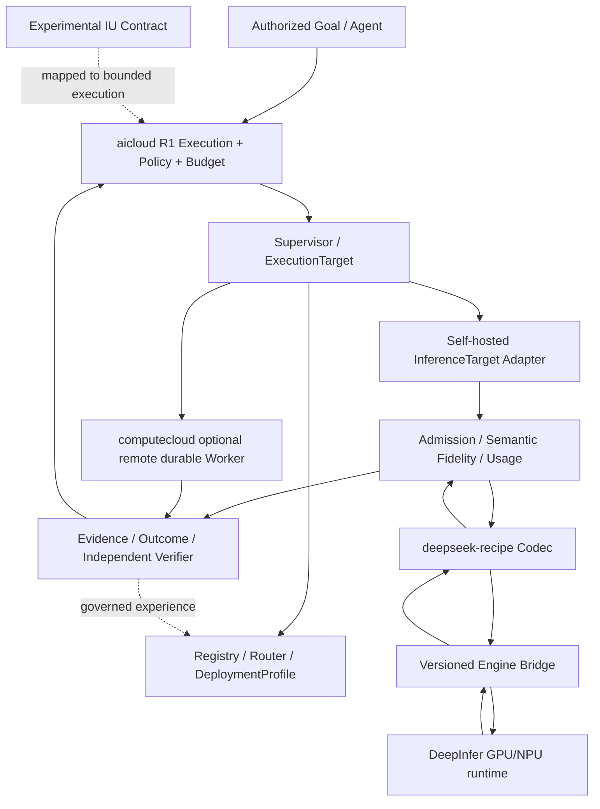

# DeepInfer × deepseek-recipe × aicloud: architecture and delivery roadmap (2026-10-22)

> Status: Proposal; not deployed or hardware-verified. [简体中文](2026-10-22-deepinfer-recipe-execution-target-integration.zh-CN.md). The Chinese companion is authoritative for the detailed work packages; maintain both in future architecture edits. The R1 Execution kernel remains authoritative.

## 0. Decisions
- aicloud owns Execution, ExecutionPlan, ExecutionTarget, Policy, Budget, Evidence, Outcome and Experience; Registry/Router/Gateway/Eval remain governed model capabilities.
- deepseek-recipe is the model protocol and token/result codec, not a tool execution service.
- DeepInfer is the accelerator runtime, not a complete production online serving stack as assumed by this proposal.
- computecloud remains the durable Job/Stage/Task/Attempt/Artifact worker executor; it does not become a gateway.
- IU remains an experimental, independently verifiable task contract, not a token, a model request or a MoE expert.
- Begin with offline GPU batches (P0); treat online serving (P1) as an independent engineering effort.
- Confirm both actual forks. The connected GitHub repository search resolved `tommyxie2026-tech/deepseek-recipe`, but did not find a DeepInfer fork.

## 1. Architecture

## 2. Proposed integration contracts (not implemented)
- `ModelRevision`: model ID, weights/tokenizer revisions, licensing, resource requirements.
- `DeploymentProfile`: codec/runtime SHAs, OCI digests, hardware, topology, context/KV budget and health.
- `InferenceRequestEnvelope`: execution and attempt IDs, idempotency, required capabilities, policy scope, deadline and budget.
- `InferenceResultEnvelope`: artifact refs, effective capabilities, semantic losses, usage, finish reason and trace.
- `InferenceTargetAdapter`: SubmitBatch/Poll/Cancel/Collect/Health; Streaming/Backpressure requires P1.
- Independent verifier: schema, functional and environmental evidence, not merely valid JSON or speculative token acceptance.

## 3. Deployment boundary
Run aicloud control-plane services on non-GPU nodes. Use an isolated Kubernetes GPU node pool for pinned Recipe/DeepInfer bridge images and read-only model weights. Admit immutable batches, emit attempt-specific outputs, check complete coverage, and publish by conditional idempotent commit. Do not expose the mock sample server to production users. Confirm real GPU hardware requirements from version-pinned sources and onsite tests.

## 4. Phased roadmap and acceptance gates
| Phase | Deliverable | Acceptance |
|---|---|---|
| DI-00 | Fork/source/model/license/hardware provenance | Pin SHAs, OCI digest and weights; confirm GPU |
| DI-01 | Codec capability/fidelity adapter, negative tests | Fail closed on critical semantic loss |
| DI-02 | Real offline DeepInfer bridge and K8s Job adapter | GPU smoke, exact coverage and idempotent commits |
| DI-03 | Registry, deployment and route selection | Wrong capability/permission/hardware rejected |
| DI-04 | Observability, quota, audit, recovery | SLO and failure/security drill gates |
| DI-05 | Online KV/P-D/DP/stream/cancel PoC | Real load, concurrency, quality and stability gate |
| DI-06 | IU contract and verified-task benchmark | Same-budget strong-baseline comparison; no claims before evidence |

Sequence PRs as documentation/ADR, codec+tests, offline adapter+fake K8s, GPU smoke and manifests, telemetry/router, then online PoC.

## 5. Observability and tests
Track verified success, cost per verified task, latency p50/p95, retries and cancellation; model token usage, TTFT/TPOT, tokens/s/GPU, batch/KV/HBM, OOM/XID, runtime revision; semantic loss and rejected unsupported capabilities. Pin model/codec/runtime releases and distinguish upstream claims from independently measured results.

## 6. Rollback and compatibility
Register the new profile as canary. Preserve previous vLLM and external providers as fallback; disable routing, drain/cancel batches, reconcile attempt artifacts and restore old routes if fidelity, performance, reliability, policy or cost gates fail. Avoid a second execution state machine: R1 remains the control-plane authority. Historic five-layer model roadmap must be interpreted as a capability view, not a competing R1 kernel.

## 7. Sources and status
- https://github.com/deepseek-ai/DeepInfer
- https://github.com/deepseek-ai/deepseek-recipe
- https://github.com/tommyxie2026-tech/devdocs/tree/main/03-incubation/projects/deepinfer-recipe-production
- https://github.com/tommyxie2026-tech/devdocs/pull/17

**Verification status:** design only; fork diff, hardware smoke, load tests and production deployment remain pending.
