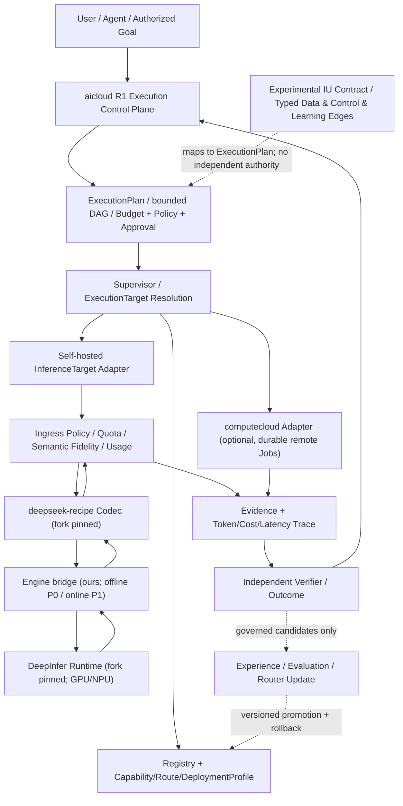

# DeepInfer × deepseek-recipe × aicloud：架构增量与迭代路线（2026-10-22）

> 状态：Proposal / 未部署 / 需要 GPU 和 K8s 验证。本文为当前 R1 Execution Kernel 的**兼容性增量**，不把历史 M0–M7 五层架构误认为当前唯一主线。实现前锁定 fork、上游 commit、权重修订、容器镜像摘要和许可。
>
> 上游：[DeepInfer](https://github.com/deepseek-ai/DeepInfer) | [deepseek-recipe](https://github.com/deepseek-ai/deepseek-recipe)
> 已确认账号 fork：`tommyxie2026-tech/deepseek-recipe`；本次连接的 GitHub 搜索未发现 `DeepInfer` fork，实施前须确认实际仓库路径与权限，禁止臆测。

## 0. 决策摘要

1. **aicloud 仍持有 Execution / Plan / Target / Policy / Evidence / Outcome / Experience 契约**，已有 Registry/Router/Gateway/Eval 作为模型能力子系统；不将其重写成 DeepInfer 的调度器。
2. **Recipe 只处理模型协议和 token/response 编解码**；由 aicloud 的 `CodecAdapter` 负责能力协商、schema/工具语义保真与失败关闭。
3. **DeepInfer 负责模型推理、GPU/NPU 并行与离线计算**；`InferenceTargetAdapter` 将其暴露为受控 `ExecutionTarget`。它不是 aicloud 的内嵌库，也不是天然可用的生产级在线 API。
4. **computecloud 继续是持久化 Job/Stage/Task/Attempt/Artifact 的分布式作业执行后端**；aicloud 不复制其执行真相，也不要求 computecloud 承担 LLM Gateway/模型服务。
5. **IU 为独立的研究性任务语义契约**：可以定义启动条件、策略、状态、环境、输出、独立验证和资源界限；不等同于 token、DeepInfer sequence、MoE expert 或一次模型请求。需经过独立实验才能升为生产基础抽象。
6. **优先 P0 离线受控批推理，之后 P1 在线 serving**；当前上游在线 KV 管理、P/D 分离、跨副本路由等能力边界必须现场复核，不能把示例 Mock Server 或离线脚本作为在线生产服务。

## 1. 目标架构（增量，Mermaid）



**边界**：模型 Token 的推测解码验证不等于任务完成验证；Recipe 的工具调用解析不等于工具授权执行；K8s Job Completed 不等于业务 Output Commit。所有外部工具及高风险变更仍需 Policy/Approval/Tool Host。

## 2. 接口增量（目标协议，未实现）

```yaml
ExecutionTarget:
  kind: self_hosted_inference
  profile_ref: deepseek-v41-flash-sm100-batch
  version: pinned
  capabilities:
    modalities: [text]
    streaming: false
    tools: false
    output_constraints: []
  data_classification: internal
  runtime:
    kind: deepinfer_offline
    model_revision: REQUIRED_PIN
    codec_revision: REQUIRED_PIN
    engine_revision: REQUIRED_PIN
  limits:
    timeout_seconds: 3600
    max_batch_items: 100
  verification:
    output_coverage: exact
    critical_semantic_loss: reject
```

以上 YAML 是**建议的 aicloud profile 字段**，不是当前源码中已定义的对象。Runtime 实际支持的能力以测试为准，不能从模型支持 JSON 推断桥接层已经实现 strict schema。至少定义：

- `ModelRevision`: model_id / weights_revision / tokenizer_revision / license / precision / model bytes / hardware profile。
- `DeploymentProfile`: runtime/codec commit SHA、镜像 digest、GPU 型号/数量、driver/CUDA/CANN、拓扑、上下文与 KV 预算、健康状态。
- `InferenceRequestEnvelope`: execution_id / attempt_id / idempotency_key / policy_scope / required_capabilities / deadline / budget / input_refs。
- `InferenceResultEnvelope`: generated artifact refs / actual effective capabilities / semantic_loss[] / usage / runtime version / finish reason / trace / result coverage。
- `InferenceTargetAdapter`: SubmitBatch / Poll / Cancel / Collect / Health；P1 单独增加 Stream、Admission、Backpressure。不可借用 Mock 接口冒充真实推理。
- `Verifier`: schema validation + task-specific functional validation + external side-effect evidence；和 codec 解码解耦。

## 3. 部署拓扑和数据流

```text
aicloud control plane (non-GPU nodes)
   ├── Registry/Router/Policy/Budget/Target Adapter
   ├── secrets refs + OIDC/RBAC + audit/OTEL
   └── Kubernetes Job submission / computecloud target (optional)
         ↓ immutable request manifest + run/attempt ID
Kubernetes GPU node pool (isolated namespace, verified hardware)
   ├── DeepInfer image (pinned) + Recipe/Bridge (pinned)
   ├── read-only weights + input artifacts
   └── attempt-specific output + usage/evidence
         ↓ object store conditional publish + independent verification
aicloud Outcome ledger / cost & health dashboards
```

P0：单批提交、不可变输入、按 attempt 隔离输出、严格覆盖率核对、幂等业务提交、失败由控制面重调度；不开放公网 HTTP，不承诺 Chat/SSE/tool-calling。模型与 GPU 资源下限需根据官方硬件要求和现场资源评估，而不是硬编码“8 卡最低配置”。

P1：真正在线 API 之前先完成服务化设计和源码差距验证，包括 KV Cache 生命周期、Prefill/Decode 资源分离、DP 副本路由、Cancel/Deadline、流式响应、反压/容量隔离、故障恢复、多租户策略和 OTel。P0 和 P1 使用**不同的部署/验收清单**。

## 4. 迭代路线与 PR 工作包

| 增量 | 依赖 | 工作包 / 交付 | 完成标准 |
| --- | --- | --- | --- |
| DI-00 基线冻结 | 无 | 识别两个 fork、上游 SHA、模型许可和权重、硬件/镜像矩阵；能力缺口清单 | Reproducibility manifest + license / provenance gate |
| DI-01 Codec + Contract | DI-00 | Recipe adapter、正负例、loss report、模拟 Engine 回放测试 | 同一契约在转换中无未报告的关键语义损失；fail closed |
| DI-02 Offline Target | DI-01 | DeepInfer offline bridge、K8s GPU Job、Result Envelope、幂等提交 | 真机输出覆盖率 100%，失败/重复提交注入通过 |
| DI-03 Registry & Routing | DI-02 | DeploymentProfile、Capacity/Health、版本路由、降级选择 | 硬件/权限/能力不匹配必须拒绝；可无损停用 |
| DI-04 SRE & Governance | DI-02 | OTel/Prometheus、GPU/cost、审计、配额、镜像/权重供应链 | SLO、灾备、故障注入、权限/数据隔离门禁通过 |
| DI-05 Online Serving Feasibility | DI-03,04 | KV/P-D/DP/stream/cancel/tenant POC，压测对照 | 真实负载可用性、质量、p95/TPOT/TTFT 达事先 SLO；否则保持 P0 |
| DI-06 Experimental IU | DI-02 | 任务级 IU Contract → Execution/Verifier，静态对照试验 | 相同总预算与独立判据下验证收益，不把假设升级为事实 |

**推荐 PR 划分**：1) docs+ADR；2) codec 契约与测试；3) offline adapter + fake K8s；4) GPU smoke + Job manifests；5) telemetry/profile/router；6) online PoC（单独实验分支）。每个阶段可独立回滚；不让在线 PoC 阻塞离线生产路径。

## 5. 必要观测、性能和验收

- 端到端：`verified_success_rate`、`cost_per_verified_task`、P50/P95 任务延迟、attempt/retry/timeout、取消成功率、重复外部副作用数。
- Runtime：prompt/completion token、TTFT、TPOT、tokens/s/GPU、批大小、KV/HBM、GPU 利用率、OOM/XID、MoE/通信瓶颈；区分官方上报与现场实测。
- Fidelity：必需工具/图片/strict JSON schema 是否受支持且被强制；`semantic_loss_detected`、误接受、unsupported feature、tool permission failures。
- 发布：镜像摘要与源码 SHA 可追溯、模型权重校验/许可核实、K8s RBAC/NetworkPolicy、配额与密钥管理、备份和故障演练、负载与质量基线。
- 没有经过目标 GPU、真实模型、负载和 K8s 验收，不得标记“生产已可用”。

## 6. 回滚与演进守则

新 InferenceTarget 注册为 canary，默认不抢占原有 vLLM/外部 Provider 流量。健康下降、验证成功率下降或成本超阈值时：禁用新 Profile → 排空或取消对应批次 → 按 `attempt_id` 回收与核对未提交 Artifact → 恢复旧 Router 决策。历史 Evidence 不可随意覆盖。安全和权限失败应立即中止，不能仅通过调整加权得分掩盖。

**与现有 R1 内核关系**：新模型服务应作为 ExecutionTarget 下沉，R1 的预算、批准、监督与证据仍为唯一执行治理边界；老 `docs/aicloud-product-architecture.md` 与 `docs/aicloud-implementation-plan.md` 作为历史模型平台视图，后续必须逐步对齐 R1，不应另起一套并行执行状态机。

## 7. 参考

- DeepInfer: https://github.com/deepseek-ai/DeepInfer
- deepseek-recipe: https://github.com/deepseek-ai/deepseek-recipe
- devdocs 现有 DeepInfer/Recipe 部署研究：https://github.com/tommyxie2026-tech/devdocs/tree/main/03-incubation/projects/deepinfer-recipe-production
- devdocs IU 研究：https://github.com/tommyxie2026-tech/devdocs/pull/17

> 证据状态：当前仅完成文档与 GitHub 现状检查；未进行 fork 差异对比、GPU 真机运行、API/性能测试或生产部署。
